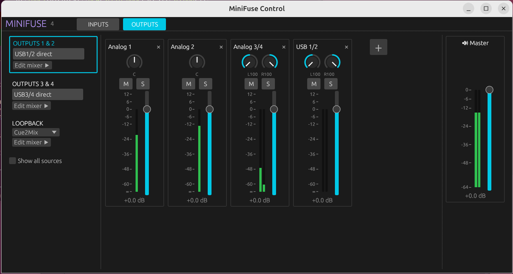

# mf-cli

Linux control for the Arturia MiniFuse 1, 2 and 4 audio interfaces: the settings that otherwise need MiniFuse Control Center on Windows or macOS. It comes as a command-line tool (`mf-cli`), a mixer window for the MiniFuse 4 (`mf-gui`), and a small kernel module that sends the commands without interrupting your audio.



## Features

- Instrument mode (INST), phantom power (+48V) and Direct Mono (MiniFuse 1/2)
- MiniFuse 4: INST on both inputs, input 3/4 gain and link, and the full Control Center mixer for Outputs 1&2, Outputs 3&4 and Loopback (level, balance, mute, solo, master, output source)
- MiniFuse 4: `mf-gui`, a mixer window like Control Center with live level meters
- MiniFuse 4: presets, and one that is applied by itself when the interface is connected
- No audio dropouts and no `sudo` when the kernel module is installed

## Installation

### From source

You need `cargo`, `libusb` (`libusb-1.0-0-dev` on Debian/Ubuntu), `make`, `dkms` and the headers of your kernel.

**1. The CLI, and the mixer window if you have a MiniFuse 4:**

```bash
git clone https://github.com/blyfoten/mf-cli
cd mf-cli
cargo build --release --features gui
sudo cp target/release/mf-cli target/release/mf-gui /usr/local/bin/
```

Leave out `--features gui` (and `mf-gui`) to build only the CLI.

**2. The kernel module:**

```bash
cd kmod
sudo make install
```

This installs the module with DKMS, which rebuilds it for every new kernel, and loads it. From then on it loads by itself whenever a MiniFuse is connected. Run `sudo make install` again after pulling a new version (with `mf-gui` closed), and `sudo make uninstall` to remove it.

With Secure Boot enabled, the module has to be signed. DKMS on Debian and Ubuntu does this with its own Machine Owner Key, which it asks you to enroll with `mokutil` the first time; elsewhere, sign it with your own key or disable Secure Boot.

**3. Without the kernel module only:** `mf-cli` then talks to the device from userspace, which briefly interrupts the audio and needs the udev rule to work without `sudo`:

```bash
sudo cp 99-minifuse.rules /etc/udev/rules.d/
sudo udevadm control --reload-rules && sudo udevadm trigger
```

**4. Applying a preset on connect (optional):** install the udev rule from step 3 (it also starts the service) and the user service:

```bash
sudo cp 99-minifuse.rules /etc/udev/rules.d/
sudo udevadm control --reload-rules
sudo cp mf-cli-autoload.service /etc/systemd/user/
systemctl --user daemon-reload
```

The service runs the `mf-cli` in `/usr/local/bin` (or `/usr/bin`), so copy the new build there as in step 1 whenever you update; an older copy fails with its usage text in the log. Then pick the preset with `mf-cli preset auto <name>`, see [Presets](#presets-minifuse-4).

### Packages

The upstream project ([nolight132/mf-cli](https://github.com/nolight132/mf-cli)) is packaged for Arch Linux (`yay -S mf-cli`) and as a NixOS flake (`hardware.minifuse.enable = true` from `github:nolight132/mf-cli`). These include the CLI and kernel module, but not `mf-gui` yet.

## Usage

```bash
mf-cli <command> [<command> ...]
```

Commands can be chained and run in order. `mf-cli --help` lists all of them.

### All models

```bash
mf-cli 48v on                          # phantom power
mf-cli inst on                         # instrument mode (input 1)
mf-cli monitor off                     # Direct Mono (MiniFuse 1/2 only)
mf-cli inst on 48v off monitor on      # chained
```

### MiniFuse 4

Sources are `in1`..`in4` (analog inputs) and `usb1`..`usb6` (computer playback), or the stereo pairs `in12`, `in34`, `usb12`, `usb34` and `usb56`, which act on both channels. Mixers are `out12`, `out34` and `loop` (Loopback).

```bash
mf-cli status                          # show all settings
mf-cli inst2 on                        # instrument mode on input 2
mf-cli gain in3 +6 link34 on           # line input 3/4 gain, linked
mf-cli mute in1 out12 off              # hear input 1 on outputs 1&2 (direct monitoring)
mf-cli level in1 out12 -6 pan L        # fader -6 dB, balance hard left
mf-cli level usb12 out12 -10           # both channels, each keeps its balance
mf-cli solo in2 out12 on
mf-cli master out12 -10
mf-cli source out12 mixer              # or "direct" to bypass the mixer
mf-cli source loop cue2mix             # usb56, cue2mix, out12 or out34
```

### Mixer window (MiniFuse 4)

Run `mf-gui`. It has the same two pages as Control Center:

- **Inputs:** a level meter per analog input, INST on inputs 1 and 2, +48V, and the gain of line inputs 3/4 with their link.
- **Outputs:** pick Outputs 1&2, Outputs 3&4 or Loopback on the left (with its USB direct switch or loopback source), then set each strip's balance, mute, solo and fader, and the master level. Strips show the level of their source; the master shows the output.
- **+** adds inputs or computer sources to the mixer, mono or as stereo pairs; **×** on a strip removes it (and mutes it, as Control Center does).

**PRESETS** at the top saves the current settings, applies or deletes saved presets, and picks the one to apply on connect.

Double-click a fader for 0 dB, or a knob to centre it. The window reads the device four times a second, so changes from the front panel or `mf-cli` show up in it.

### Presets (MiniFuse 4)

A preset holds every setting Control Center has: INST, +48V, input gain and link, and the three mixers with their strips, levels, balance, mute, solo, master and source.

```bash
mf-cli preset save studio              # save the current settings
mf-cli preset load studio              # apply them (only what differs is written)
mf-cli preset list
mf-cli preset delete studio
mf-cli preset auto studio              # apply on connect; "off" to stop
```

Presets are files in `~/.config/mf-cli/presets`; a name with a `/` in it, such as `./studio.preset`, is a path to a preset file anywhere.

The MiniFuse 4 starts with its factory settings every time it is powered on. With step 4 of the installation done, `mf-cli-autoload.service` runs `mf-cli autoload` when the interface is connected or you log in with it connected: if every setting is still at its power-on value, it applies the `preset auto` preset; if anything was changed, it leaves the device alone, so running it again after the preset was applied does nothing. `journalctl --user -u mf-cli-autoload` shows what it did:

```
[+] Applied preset 'studio'
[*] Settings were changed since power-on; not applying preset 'studio'
```

To try it without replugging, power-cycle the interface and run `systemctl --user start mf-cli-autoload`.

## How it works

Every setting is a USB control request to the interface that the Linux audio driver (`snd-usb-audio`) owns. From userspace, sending one means detaching the audio driver for a moment, which is the audio dropout. The kernel module sends the requests from inside the kernel instead, through `/dev/minifuse_cmd` (settings) and `/dev/minifuse_meters` (level meters), while the audio driver stays attached.

The MiniFuse 4 protocol is documented in [PROTOCOL-MF4.md](PROTOCOL-MF4.md).

## Credits

This is a fork of [mf-cli](https://github.com/nolight132/mf-cli), created by Pavel Olizko ([@nolight132](https://github.com/nolight132)) and sleebu ([@zxsleebu](https://github.com/zxsleebu)), who wrote the CLI and the seamless kernel module this all builds on. [@yamplum](https://github.com/yamplum) added support for MiniFuse 1 revision 1.52. Thank you!

This fork adds the MiniFuse 4 mixer commands, the level meters, `mf-gui`, and the DKMS install of the kernel module.

## License

- `mf-cli` and `mf-gui` (userspace code): [MIT License](LICENSE).
- The kernel module (`kmod/`): GNU General Public License v2.0 (GPL-2.0), as required for Linux kernel code.
